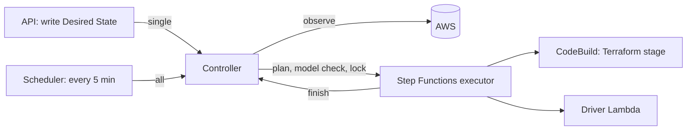

# Architecture

This document describes the state model InfraFlow reasons about, the safety properties it enforces, and the services that execute transitions.

## 1. Environment model

A **Blueprint** is a set of component **instances** connected by typed **bindings**. The `web-db@1.0.0` blueprint has five instances:

| Instance | Component | Billing class | States |
|---|---|---|---|
| `network` | `aws-network-basic` | `free` | ABSENT, PRESENT |
| `egress` | `aws-nat-egress` | `hourly_no_data` | ABSENT, PRESENT |
| `database` | `aws-rds-postgres` | `data` | ABSENT, RUNNING, STOPPED, SNAPSHOTTED |
| `app` | `aws-ec2-docker-app` | `stoppable` | ABSENT, RUNNING, STOPPED |
| `entry` | `aws-alb-https-entry` | `hourly_no_data` | ABSENT, PRESENT |

The billing class fixes the set of states an instance can be in. A `hourly_no_data` resource cannot be stopped, so sleeping means deleting it; a `data` resource can only be deleted after a snapshot.

### Levels

A **level** assigns a state to every instance.

| Level | network | egress | database | app | entry |
|---|---|---|---|---|---|
| `awake` | PRESENT | PRESENT | RUNNING | RUNNING | PRESENT |
| `deep` | PRESENT | ABSENT | STOPPED | STOPPED | ABSENT |
| `hibernate` | PRESENT | ABSENT | SNAPSHOTTED | ABSENT | ABSENT |
| `prepared` | PRESENT | ABSENT | ABSENT | ABSENT | ABSENT |
| `reclaimed` | ABSENT | ABSENT | ABSENT or SNAPSHOTTED | ABSENT | ABSENT |

`prepared` is the state after provisioning and before the first wake. `reclaimed` is terminal; the database keeps a final snapshot when the Lease data policy requires it.

A sleep level is satisfied by any state at least as cheap as its target, so an environment that is already hibernating is not woken in order to reach `deep`.

### Dependencies

A binding from instance `u` to instance `v` creates up to two edges:

- **present** `(u, v)`: `u` may exist only while `v` exists. Created when `u` reads values from `v` (for example the app reads the database host).
- **serving** `(u, v)`: `u` may serve only while `v` serves. Created when the port is declared with `when: serving`.

For `web-db`, the serving edges are `app -> database`, `app -> egress` and `entry -> app`. The app needs NAT to pull its image but reads no value from it, so there is no present edge `app -> egress`, and the app may remain STOPPED after NAT is deleted.

### System state and safety

The system state is `(sigma, dns, health, snaps)`: the state of each instance, the DNS target (`SLEEP` or `APP`), whether the health gate has passed since the last change, and which data instances have an available snapshot taken by the current operation.

| Property | Statement |
|---|---|
| A1 | For every present edge `(u, v)`: if `u` exists, `v` exists. |
| A2 | For every serving edge `(u, v)`: if `u` is serving, `v` is serving. |
| A3 | DNS points to the application only when the health gate has passed and every instance is awake. |
| A4 | A data instance is deleted only if it has an available snapshot from the current operation, or the Lease explicitly allows data loss. |

A1 to A3 are properties of states; A4 is a property of transitions.

## 2. Planning and verification

### Planner

Given the observed state and a target level, the planner produces a lifecycle plan:

1. Split changes into DOWN (stop serving, remove) and UP (create, start).
2. If DNS points to the application and the target is not `awake`, switch DNS to the sleeping page first and wait for connections to drain.
3. Run DOWN changes by decreasing depth, then UP changes by increasing depth. Changes at the same depth share a stage.
4. Within a stage, all presence changes form one Terraform apply; driver actions run in parallel.
5. Snapshot a data instance in its own stage before removing it.
6. For `awake`, run the health gate, then switch DNS to the application.

Example, `deep -> awake` for `web-db`:

```
up-1    terraform egress=true      driver rds_instance.start (database)
up-2    driver ec2_instance.start (app)
up-3    terraform entry=true
health  elbv2.target_healthy
post    dns -> APP
```

### Model checking

A plan is executed only after the model checker accepts it. Actions within a stage may complete in any order, so the checker explores every interleaving by breadth-first search over `(stage, completed actions, state)` and rejects the plan if any reachable state violates A1 to A3, any transition violates A4, or the final state differs from the target. A rejection includes a counterexample trace.

The same checker certifies each Blueprint:

| Check | Statement |
|---|---|
| C7 | Every supported level is a safe state. |
| C8 | For every pair of levels, including from `prepared` and to `reclaimed`, the generated plan passes model checking. |
| RESCUE | From every state reachable during any C8 plan, including states where an operation stopped midway, the planner has a safe plan to `deep` and to `reclaimed`. |

`ics/examples/web-db-shallow.blueprint.yaml` adds a `shallow` level (ALB present, app stopped). C7 rejects it because the ALB would serve while the app does not (A2).

### Plan Validator

Each Terraform stage runs `terraform plan -out=plan.out`, converts it with `terraform show -json`, and applies exactly that file only if the Plan Validator accepts it.

| Rule | Statement |
|---|---|
| V1 | Every resource change belongs to a Blueprint instance. |
| V2 | Only instances permitted in the current stage change. |
| V3 | A data resource is deleted only if the current operation holds an available snapshot of it. |
| V4 | A data resource is never replaced. |
| V5 | Created resources carry the required ownership tags with the correct `env_id`. |
| V6 | Updated and deleted resources carry the expected `env_id`. |
| V8 | Every resource type is declared in the component manifest and in the Resource Type Registry. |
| V9 | The root module's `compiled_hash` output matches the certified compiler output. |

Ordering safety across stages (V7) is guaranteed by the model checker before the plan is issued.

## 3. Desired State

`D(e, t)` is a pure function of the Lease, the Environment and the time `t`. Changing the activity policy in the middle of a Lease is therefore safe: the next evaluation starts from scratch. Rules, in priority order:

1. Environment `BLOCKED`: not evaluated until an administrator resolves it.
2. Lease expired or reclaimed early: `RECLAIMED`.
3. Unexpired manual override (Wake or Sleep from the console or the sleeping page): the override.
4. Before the Lease start date: asleep at the off-hours level.
5. `schedule` mode: awake inside the configured window, asleep at the off-hours level outside it.
6. `on_demand` mode: asleep at the idle level until a wake request, then awake until idle for `idle_timeout_minutes`.
7. Hybrid: in `schedule` mode with an idle timeout, an idle environment sleeps inside its window and stays asleep until activity or a wake request.

The off-hours and idle levels are each `deep` or `hibernate`, set per Lease.

Break-even rule: NAT and ALB are billed per started hour, so an environment is not put to sleep for idleness before it has been awake for `min_awake_minutes` (default 60).

Activity is measured as ALB `RequestCount` over the last five minutes.

## 4. Control loop



| Mode | Trigger | Purpose |
|---|---|---|
| `single` | API, after writing Desired State | Reconcile one Environment immediately. |
| `all` | EventBridge Scheduler, every 5 minutes | Reconcile every Environment; repairs drift such as an instance started from the console. |
| `finish` | Executor, at the end of an operation | Record the outcome, update observed state, release the lock. |
| `sweep` | EventBridge Scheduler, hourly | Report tagged resources that belong to no live Environment. Never deletes. |

The lock is the Environment's `active_operation_id`, set with a DynamoDB conditional write. Terraform state for each Environment lives in S3 with `use_lockfile`. A second request with the same target returns the running operation; a request with the opposite target is rejected with `409 CONCURRENT_OPERATION`.

### Failure handling

| Condition | Outcome |
|---|---|
| Planner or model checker rejects the transition | Nothing is executed; the Environment becomes `BLOCKED` with `PLAN_UNSAFE` and the counterexample. |
| Health gate fails after Wake | The URL stays on the sleeping page; a two-hour Sleep override puts the Environment back to `deep` (`HEALTH_GATE_FAILED`). |
| Plan Validator rejects a stage | The stage is not applied; the Environment becomes `BLOCKED` with `PLAN_UNSAFE`. |
| Any other executor failure | The Environment becomes `BLOCKED` with `EXECUTION_FAILED`. |
| Operation exceeds its deadline (Provision 30, Wake 45, Sleep 30, Reclaim 75 minutes) | The Environment becomes `BLOCKED` with `UNKNOWN_OUTCOME`; an administrator resolves it. |
| Resources remain after Reclaim | Verify retries on later passes, then blocks with `VERIFY_FAILED`. |

## 5. Platform services

| Service | Role |
|---|---|
| API Gateway HTTP API + Lambda (`api`) | Management API (Cognito JWT) and public sleeping-page API. Has no infrastructure permissions. |
| Lambda (`controller`) | Desired State, observation, planning, model checking, locking, Verify, orphan sweep. |
| Step Functions | Executes the lifecycle plan stage by stage. |
| CodeBuild | Trusted Terraform runner: compile, init, plan, validate, apply. |
| Lambda (`drivers`) | The closed Driver Registry: start, stop, snapshot, observe, health gate, DNS. |
| DynamoDB | Leases, Environments, operations, state transition log, idempotency keys, orphans. |
| S3 | Per-Environment Terraform state; operation artifacts (plans, validation reports). |
| S3 + CloudFront | Management console and sleeping page. |
| Cognito | Console users, with organization and administrator claims. |

The platform is serverless and costs close to nothing while no Environment is awake.
